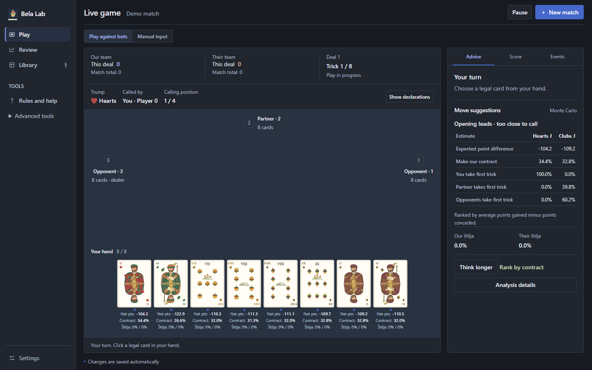

# Bela Lab 1.0.0

Bela Lab is a free Windows desktop app for playing, tracking and reviewing
four-player Croatian Bela. Games and analysis run on your computer.

## Run the Windows app

**[Download Bela Lab 1.0.0 Setup for Windows](https://github.com/AleksejLeonG/Belote_engine/releases/download/v1.0.0/Bela-Lab-1.0.0-Windows-x64-Setup.exe)** · [Release notes and checksums](https://github.com/AleksejLeonG/Belote_engine/releases/tag/v1.0.0)

*Opening advice during a demo match. The app compares expected deal points,
contract odds, and who might take the first trick.*

Sign in to GitHub with access to this repository, download Setup from the
release, and follow the wizard. Then open **Bela Lab** from the Start menu.
Setup installs for your Windows account and creates an entry in **Settings →
Apps → Installed apps**. Uninstalling there keeps your saved games, analysis,
notes, and preferences.

The app requires Windows capable of running x64 programs and
[Microsoft Edge WebView2 Evergreen Runtime](https://developer.microsoft.com/microsoft-edge/webview2/).
Setup is unsigned. The [release page](https://github.com/AleksejLeonG/Belote_engine/releases/tag/v1.0.0)
also offers a portable ZIP if you prefer to run the app from an extracted folder.

- **Play against bots** to practice a full match, from trump calling to scoring.
- **Manual input** records a game played elsewhere and provides advice from your hand and observed play.
- **Review** replays a saved match, compares moves and lets you explore alternate lines.
- **Library** opens, imports and exports player match archives.

Move advice compares legal cards using Monte Carlo trials and solves small
endgames exactly when the work limit allows. Near the end of a match, it can
rank by the chance of winning or keeping the match alive. Probabilities are
model estimates. The opening lead comparison shows deal points, contract odds
and who might take the first trick.

The interface supports English and Croatian, light and dark appearance, and
Hungarian and standard card faces. **Rules and help → About Bela Lab** shows the
version and release documents.

## An endgame the engine can solve exactly

On trick seven of a test deal, the player could lead **7♥** or **8♥**. The
engine reconstructed all **12** remaining card layouts consistent with the
player's hand, declarations, and play so far. In every layout, both leads
produced the same settled score across all legal continuations considered.
Both broke the opposing contract in four layouts.

Review gives the two cards equal credit. The **33.3%** contract estimate comes
from weighting the 12 layouts equally. The tie held in each layout, independent
of how the layouts were weighted.

## Saves and support

The Windows app normally stores data in **%LOCALAPPDATA%\Bela Lab**. Export a
match from Library before sharing it. Back up or delete the data folder while
the app is closed. See the [Privacy Policy](PRIVACY.md) for what the folder
contains and how to remove it.

- [Terms of Use](TERMS.md) and [Privacy Policy](PRIVACY.md)
- [Project rights](LICENSE.md) and [third-party notices](NOTICE.md)
- [Release notes](CHANGELOG.md)
- [Report a problem](https://github.com/AleksejLeonG/Belote_engine/issues) or [report a security issue](SECURITY.md)

## Build and develop

The Python engine and browser dashboard require Python 3.11 or newer. Start
the local dashboard with **python app/run.py**. **START_BELA.cmd** opens the
installed desktop app from a checkout.

- [Windows build and release instructions](docs/DESKTOP_APP.md)
- [Croatian Bela rules used by the engine](docs/RULES.md)
- [Development, tests and benchmarks](docs/DEVELOPMENT.md)
- [Project status](docs/PROJECT_STATUS.md) and [documentation index](docs/README.md)
