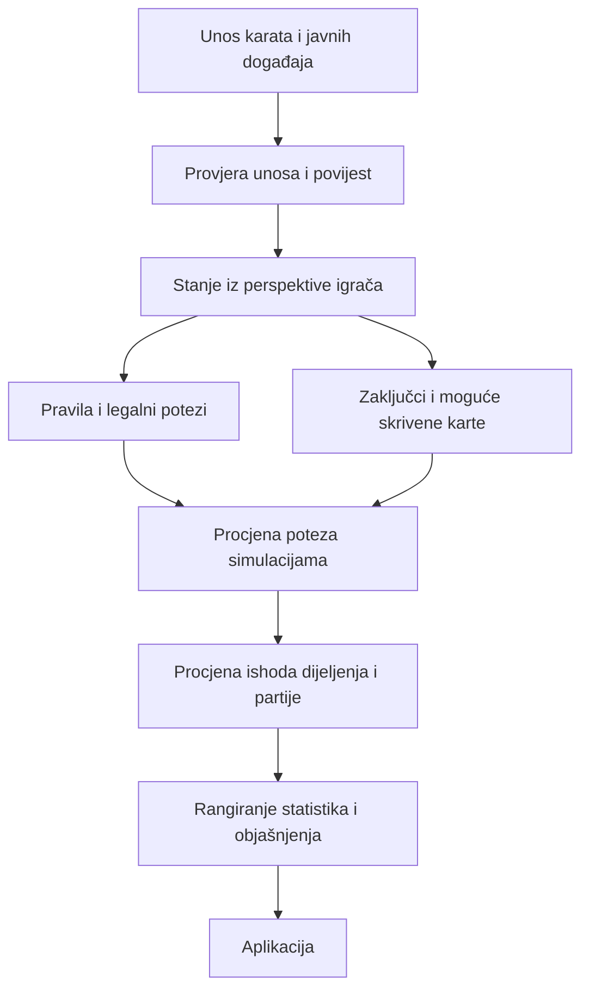

# Framework za Bela Engine

Datum: 23. listopada 2026. Status: predložena arhitektura za implementaciju.

Pravila igre definirana su u [RULES.md](RULES.hr.md). Ovaj dokument opisuje sustav koji ih provodi i daje preporuke. Algoritmi, tehnologije i razvojne faze ovdje su prijedlog izvedbe, a ne nova pravila igre.

## 1. Cilj proizvoda

Aplikacija prati partiju iz perspektive jednog igrača. Korisnik unosi svoje karte, rezultat, adut, zvanja i odigrane karte. Nakon svake nove informacije app ažurira stanje, zaključke i preporuke. Partnerove neotkrivene karte ostaju skrivene kao i protivničke.

Za svaki legalni potez prikazuje procijenjene ishode, razlog preporuke i koliko su procjene pouzdane. Konačni cilj je povećati vjerojatnost pobjede našeg para u partiji. Dobivanje trenutnog štiha i skupljanje više bodova u dijeljenju pomoćne su metrike, koje ponekad vode drukčijem izboru.

Izraz najbolji potez znači najbolji procijenjeni potez pod navedenim modelom i računalnim budžetom. U igri sa skrivenim informacijama ne obećavamo matematički optimalnu strategiju ni univerzalnu vjerojatnost uspjeha.

## 2. Korisnički tijek

1. Nova partija: odabrati vlastito mjesto, djelitelja i početni ukupni rezultat. Partner je automatski nasuprot.
2. Odabrati početak unosa: prije zvanja aduta, nakon podizanja talona ili usred dijeljenja.
3. Unijeti vlastitih šest ili osam karata, ovisno o fazi. Kod naknadnog unosa razlikovati početnu i trenutačnu ruku.
4. Evidentirati tko je rekao dalje, tko je zvao i koji je adut. Savjetovanje pri zvanju dolazi u kasnijoj fazi razvoja.
5. Unijeti javne izjave o zvanjima, ishod usporedbe i stvarno pokazane karte s vlasnicima. Nepoznat detalj ostaviti nepoznatim.
6. Tijekom igre dodavati igrača i odigranu kartu. Aplikacija prati redoslijed, štihove i bodove.
7. Kada smo na potezu, dobiti rangirane legalne karte. Nakon tuđeg poteza vidjeti ažurirane informacije; preporuka se daje za sljedeću stvarnu odluku našeg igrača.
8. Pogrešku ispraviti kroz povijest. Sustav ponovno izračunava sve što ovisi o ispravljenom podatku.
9. Na kraju dijeljenja potvrditi obračun; app ažurira rezultat i djelitelja ili završava partiju.

Prva verzija podržava strukturirani odabir karata. Slobodan tekst, glas i fotografije kasnije se prevode u iste strukturirane unose, uz potvrdu prepoznatih podataka prije njihove primjene. Sučelje koristi hrvatske nazive i sinonime boja iz pravila.

## 3. Arhitektura



Pravila su zajednička aplikaciji, simulatoru i testovima. Sučelje ne implementira vlastitu verziju obračuna ili ibera. Cijeli sustav u početku radi kao jedan lokalni program s odvojenim modulima; nema potrebe za mikroservisima.

### Slojevi i odgovornosti

| Modul | Odgovornost | Glavni rezultat |
|---|---|---|
| `domain` | Karte, mjesta, parovi, faze i oznake pravila | Jednoznačni tipovi podataka |
| `rules` | Legalni potezi, štihovi, zvanja, bela, bodovanje i završetak | Deterministički rezultati |
| `session` | Događaji, revizije, spremanje i ponovno odigravanje zapisa | Provjerljiva povijest |
| `knowledge` | Znanje pojedinog igrača i zaključci iz pravila | Ograničenja nad skrivenim kartama |
| `belief` | Generiranje i ponderiranje mogućih skrivenih raspodjela | Uzorci mogućih stanja |
| `policies` | Modeli budućih odluka partnera i protivnika | Akcija iz dopuštenog pogleda igrača |
| `simulation` | Odigravanje dijeljenja i partija | Ishodi pod zadanim modelom |
| `search` | Raspodjela vremena među potezima i istraživanje nastavaka | Kandidati i procjene vrijednosti |
| `evaluation` | Provjera kvalitete i statistička usporedba verzija | Izvještaji i regresijski skup |
| `advisor` | Rangiranje, bliski izbori i objašnjenja | Strukturirana preporuka |
| `api` i `ui` | Komunikacija i korisnički unos | Aplikacija |

## 4. Tri različita pogleda na stanje

### Potpuno stanje simulatora

`FullGameState` sadrži sve četiri ruke, početne talone i cijelu povijest. Koristi se za simulacije i provjeru pravila. U stvarnoj sesiji ne pretpostavljamo da to potpuno stanje poznajemo.

### Dopušteni pogled igrača

`PlayerObservation` sadrži vlastite dopušteno poznate karte, javnu povijest, javno pokazane karte i rezultat. Modul za odluku prima taj pogled. Svaki simulirani igrač dobiva svoj pogled, uključujući partnera.

Zajednički cilj para ne znači zajedničko znanje karata. Partner ne smije u simulaciji igrati kao da vidi našu ruku, osim njezinih javno otkrivenih dijelova.

### Model skrivenih informacija

`BeliefState` predstavlja raspodjelu mogućih potpunih stanja koja odgovaraju opažanju. Uključuje dopuštene vlasnike karata, preostale veličine ruku, objavljena zvanja i ograničenja izvedena iz legalnog igranja.

Ova razdvojenost mora biti provedena kroz sučelja modula, a ne samo programerski dogovor. Test: uz isti dopušteni pogled i isti slučajni seed promjena stvarne skrivene raspodjele ne smije promijeniti odgovor savjetnika.

## 5. Podaci i faze igre

Karta ima stabilnu oznaku 0–31 i par boja–rang. Čitljivi format za razmjenu može biti `H_J`, `S_A`, `D_10`, `C_7`: herc, pik, karo i tref. Format se dokumentira i ostaje neovisan o nazivu prikazanom korisniku.

Mjesta 0, 1, 2, 3 definirana su u smjeru igranja. Sljedeće mjesto je `(p + 1) mod 4`, partner `(p + 2) mod 4`, a prvi nakon djelitelja `(dealer + 1) mod 4`. Prikaz stola preslikava ta mjesta u hrvatski smjer igre.

Osnovni podaci sesije:

- Identitet sesije, verzija sheme, verzija pravila i trenutačna revizija.
- Mjesto korisnika, partner, djelitelj i ukupni rezultat prije dijeljenja.
- Faza, igrač na redu, zvatelj, adut i povijest odluka pri zvanju.
- Vlastita početna i trenutačna ruka, ako su poznate; talon odvojeno od prvih šest karata.
- Javne izjave o zvanjima, pokazane kombinacije i karte, pobjednik usporedbe.
- Svi odigrani potezi, dovršeni štihovi, trenutačni štih i objava bele vezana uz konkretan potez.
- Bodovi karata, broj štihova i uvjetni dodaci; konačno priznati bodovi računaju se na kraju.
- Stupanj potpunosti povijesti i izvor svakog dodatnog podatka.

Predložene faze: `BIDDING`, `TALON_PICKUP`, `DECLARATIONS`, `PLAYING`, `DEAL_FINISHED`, `MATCH_FINISHED`. Priprema sesije odvojena je od tijeka igre. Belot može završiti partiju iz odgovarajuće faze nakon zakonitog otkrivanja i potvrde.

Pri zvanju aduta uzorkuju se i dvije naše nepoznate karte talona. Dok ne dođe red igrača za gledanje početnih šest, ni simulirana politika ne dobiva tih šest. Početnih šest i talon moraju ostati razlučivi pri kasnijoj procjeni ranijih odluka da se kaže dalje.

## 6. Događaji umjesto ručnog mijenjanja stanja

Sesija se gradi iz uređenih događaja, examplesce:

```text
MatchStarted
DealStarted
OwnInitialCardsRecorded
BidPassed
TrumpCalled
OwnTalonRecorded
DeclarationPresenceAnnounced
DeclarationValueAnnounced
SequenceHighCardAnnounced
CardsRevealed
DeclarationContestResolved
CardPlayed  [uz bela_announced kada je primjenjivo]
DealSettled
```

Svaki događaj ima identitet, redni broj, reviziju, aktera kada postoji i strukturirani sadržaj. Sustav razlikuje korisnički opažen događaj od vlastitog izvedenog podatka. Završetak štiha i većina bodova izvode se iz poteza; ne traže se ponovno od korisnika.

Ispravak stvara novu reviziju ili oznaku zamjene događaja. Iz stare povijesti ne brišemo trag ispravka. U novoj reviziji ponovno gradimo stanje i znanje, poništavamo stare analize i provjeravamo sve sljedeće poteze. Ako izmjena aduta učini kasnije poteze nemogućima, označujemo točne događaje koje treba ispraviti.

Svaki rezultat analize nosi reviziju stanja. Kada stigne nova informacija, pokrenuta analiza može se prekinuti; dovršeni rezultat stare revizije ne smije zamijeniti novu preporuku.

## 7. Činjenice, zaključci i pretpostavke

| Vrsta informacije | Primjer | Postupanje |
|---|---|---|
| Unesena ili javno opažena činjenica | Igrač je odigrao pik 7 | Obvezno ograničenje ako nema proturječja |
| Zaključak iz pravila | Nije pratio pik pa nema preostali pik u tom trenutku | Obvezno ograničenje uz sačuvan razlog |
| Strateška pretpostavka | Zvao je herc pa je vjerojatnije jak u hercu | Vjerojatnosna težina modela |
| Nesiguran korisnički podatak | Mislim da je najavio 50 | Odvojen scenarij ili nepotvrđen unos |

Primjeri sigurnih zaključaka pri pretpostavci pravilnog igranja:

- Nepratiti početnu boju znači da je igrač u tom trenutku nije imao.
- Odbaciti neadutsku kartu kada nema početnu boju znači da nema ni adut.
- Odigrati slabiji adut kada je nadjačavanje obvezno znači da u tom trenutku nije imao jači adut od najjačeg na stolu.
- Pratiti neadutsku boju slabijom kartom dok štih nije presječen znači da nije imao kartu te boje jaču od trenutačno najjače.
- Nakon presijecanja nema posljednjeg zaključka: slabija karta početne boje tada je dopuštena i uz posjedovanje jače.

Ograničenja su vremenska. Pokazana karta opisuje posjedovanje u trenutku pokazivanja; nakon odigravanja više nije u ruci. Belina objava otkriva posjedovanje druge karte para K–Q u relevantnom trenutku. Rekonstrukcija vraća karte unatrag kad provjerava ranije poteze.

Najava 50 ne otkriva automatski boju ni točne karte. Najava 100 može označavati više vrsta zvanja. Takav podatak mora ostati skup dopuštenih kombinacija, bez proizvoljnog odabira jedne. Ishod javne usporedbe također može ograničiti najjače zvanje gubitničkog para, koliko to proizlazi iz zabilježenih izjava.

Svaki izvedeni zaključak treba imati poveznicu na događaj i pravilo, kako bi app mogla objasniti razlog i povući zaključak nakon ispravka.

## 8. Provjera unosa i nepotpuna povijest

Provjeravamo duplikate, redoslijed, broj karata, dostupnost karte, zvanja, bodove i postojanje barem jedne zajednički moguće raspodjele svih skrivenih karata. Odvojena provjera dopuštenih vlasnika svake karte nije dovoljna ako ne postoji raspodjela koja zadovoljava sve veličine ruku i zvanja zajedno.

Za vlastitu poznatu ruku legalnost poteza provjerava se potpuno. Kod tuđeg poteza bez poznate ruke provjeravamo postoji li skrivena ruka s kojom je taj potez legalan te ažuriramo ograničenja. Ne tvrdimo da je tuđi potez nelegalan samo zato što je nelegalan u jednom nasumičnom uzorku.

Kod proturječja prikazujemo konkretan uzrok, examplesce: „Igrač 1 ranije nije pratio herc, a sada mu je unesena neodigrana herc karta.” Ne proizvodimo preporuke iz nemogućeg stanja i ne popravljamo korisničke činjenice naslijepo.

Prva funkcionalna verzija traži potpun zapis tekućeg dijeljenja. Kasnije uvodimo početak usred dijeljenja. Tada su potrebni vlastita trenutačna ruka, adut, zvatelj, djelitelj, igrač na redu, preostale veličine ruku, odigrane karte i dovoljno bodovnih podataka za nastavak. Bez redoslijeda ranijih poteza ne možemo izvesti sve zaključke o iberu i bojama. Takva se analiza označava nepotpunom i koristi slabija ograničenja; ne izmišljamo izgubljenu povijest.

## 9. Model mogućih raspodjela

Početna verzija uzorkuje raspodjele jednoliko među raspodjelama koje zadovoljavaju unesene činjenice i pravila, uz model poštenog slučajnog dijeljenja. Zvanje aduta i odluke dalje u toj verziji evidentiramo, ali njihovo strateško značenje još ne koristimo za ponderiranje. Tu pretpostavku navodimo u metapodacima analize.

Praktičan početak je generator s provjerom kapaciteta ruku i vraćanjem na prethodni korak. Njegovu uniformnost treba dokazati ili izmjeriti na malim potpuno prebrojivim examplesma; naivno nasumično dodjeljivanje karata uz vraćanje ne jamči uniformnost. Za male slučajeve koristimo potpuno nabrajanje, a za veće provjeren postupak uzorkovanja ili korekciju težinama.

Svaki uzorak provjerava se rekonstrukcijom cijele dostupne povijesti, uključujući javne tvrdnje o zvanjima. Nula prihvaćenih uzoraka znači proturječje, premalen budžet ili loš generator; ta tri slučaja moramo razlikovati prije poruke korisniku.

Kasnije uvodimo vjerojatnost povijesti pod modelom ponašanja: koliko je vjerojatno da bi taj igrač s tom rukom rekao dalje, zvao ili odigrao određenu legalnu kartu. Ti modeli mijenjaju težine, a ne osnovna pravila. Kod ponderiranih uzoraka pratimo efektivan broj uzoraka i degeneraciju težina.

## 10. Put do jakog savjetnika

### Prvi korak — jednostavne politike i simulator

Napraviti slučajnog legalnog igrača i jednostavnog igrača s jasnim heuristikama. Oni omogućuju automatsko odigravanje cijelih dijeljenja i provjeru da simulator radi. Heuristike su početna usporedba, ne završni dokaz kvalitete.

### Drugi korak — usporedba poteza simulacijama

Za svaki legalni potez uzorkovati moguća skrivena stanja, odigrati kandidata i simulirati ostatak dijeljenja. Svaki budući igrač bira akcije iz vlastitog dopuštenog pogleda. Jednaka skupina skrivenih raspodjela koristi se za usporedbu kandidata radi smanjenja šuma; nastavci i njihova slučajnost moraju biti dosljedno definirani.

Time dobivamo prvu upotrebljivu procjenu očekivanih upisanih bodova, prolaza ili rušenja i drugih ishoda. Kvaliteta ovisi o modelu nastavka. U početku rangiramo prema očekivanoj razlici konačno upisanih bodova dijeljenja i to izričito označavamo kao privremeni cilj.

### Treći korak — pretraživanje sa skrivenim informacijama

Uvesti pretraživanje koje odluke povezuje s informacijama dostupnim igraču, examplesce prilagođeni ISMCTS. Ne pretražujemo samo više nasumičnih nastavaka: istražujemo koje su buduće odluke bolje, uz pravilan prikaz znanja svih četiriju igrača.

Ako za svaki mogući raspored koristimo potpuno informiranog rješavača i rezultate proglasimo stvarnim izgledima, pretpostavili bismo znanje skrivenih karata. To može dati pogrešnu sliku kvalitete poteza. Potpuno informirani rješavač ostaje koristan za dijagnostiku i završnice u kojima su sve relevantne karte doista poznate. Sam izbor algoritma ISMCTS također ne jamči uklanjanje svih problema s informacijama; to provjeravamo zasebnim testovima.

### Četvrti korak — ukupan rezultat i pobjeda u partiji

Za nastavak koji završava partiju nagrada je 1 za našu pobjedu i 0 za poraz. Za ostale ishode procjenjujemo vrijednost novog ukupnog rezultata i sljedećeg djelitelja, pod definiranim modelom budućih dijeljenja i igrača:

```text
vrijednost poteza = prosjek V(novi rezultat, sljedeći djelitelj, naš par, model igrača)
```

`V` se najprije može procjenjivati simuliranjem ostatka partije izvan aktivnog upita i spremanjem rezultata. Potom se može aproksimirati modelom treniranim na takvim ishodima. Uvijek poštujemo granicu strogo iznad 1000, pad prije završetka i dodatno dijeljenje kod izjednačenja. Ako se nijedan ishod još nije razriješio, razliku rezultata ne nazivamo vjerojatnošću pobjede.

Taj sloj omogućuje da pri rezultatu blizu kraja app preferira potez koji češće donosi konačnu pobjedu, čak i kada drugi potez prosječno donosi više bodova u dijeljenju.

### Peti korak — zvanje aduta

Na temelju šest poznatih karata usporediti četiri boje i dalje. Za dalje treba simulirati odluke preostalih igrača, uključujući mogući mus i raspodjelu talona. Na musu akcija dalje nije dostupna. To je zaseban problem pretraživanja, pa dolazi nakon pouzdanog odigravanja karata.

### Kasnija istraživanja

Učenje iz samostalnog igranja, modeli konkretnih stilova partnera i protivnika te CFR/MCCFR mogu biti istraživački smjerovi. Ne pretpostavljamo da se teorijska jamstva za dvaju igrača sa suprotnim ciljevima izravno prenose na četiri igrača u dva para s odvojenim informacijama. Novi pristup ulazi u proizvod tek kad pokaže mjerljivo poboljšanje.

## 11. Statistike i više dobrih izbora

Za svaki potez izvještaj treba razlikovati:

- Vjerojatnost da naš par osvoji trenutni štih, kada je to primjenjivo.
- Vjerojatnost da par koji je zvao prođe. Sučelje to prevodi u naš prolaz ili naše rušenje ovisno o ulozi para.
- Očekivane konačno upisane bodove obaju parova i njihovu razliku, nakon pada i svih dodataka.
- Vjerojatnost pobjede našeg para u partiji, tek kada postoji model nastavka partije.
- Broj uzoraka, efektivan broj ako su ponderirani, trajanje, metodu, verziju politika i potpunost unosa.
- Statističku nesigurnost i osjetljivost na drukčije modele protivničke igre kada je ta usporedba dostupna.

Razlika 63 % naspram 62 % ne znači automatski da je prvi potez bolji. Procjenjujemo razliku poteza na uparenim uzorcima. Ako nema dovoljno dokaza za razliku, prikazujemo ih kao bliske izbore; mogu imati različite raspodjele bodova i rizika. Oznaka bliskih izbora temelji se na unaprijed definiranoj praktičnoj toleranciji i nesigurnosti, a ne samo preklapanju pojedinačnih intervala.

Interval iz simulacije opisuje pogrešku uzorkovanja pod zadanim modelom. Ne pokriva automatski pogrešan model ponašanja igrača ili pogrešno unesene podatke. Za obične neovisne binarne ishode možemo koristiti Wilsonov interval; za ponderirane, povezane ili adaptivno prikupljene rezultate treba odgovarajuća metoda.

Nakon pretraživanja vodeće kandidate provjeravamo na zasebnim uzorcima, kako rezultati odabranog pobjednika ne bi bili precijenjeni samo zato što je odabran među šumnim procjenama. Kod ponavljanog provjeravanja tijekom analize ne tvrdimo standardnu pokrivenost intervala bez prikladnog postupka.

Prototip prikaza, bez izmišljenih stvarnih rezultata:

| Potez | Pobjeda u partiji | Naš prolaz ili rušenje | Očekivana razlika upisa | Ocjena |
|---|---|---|---|---|
| Karta A | Procjena i interval | Procjena | Bodovi | Preporučeno |
| Karta B | Procjena i interval | Procjena | Bodovi | Blizak izbor |
| Karta C | Procjena i interval | Procjena | Bodovi | Slabije prema modelu |

Dok model partije nije dostupan, pripadajući stupac prikazuje „još nije dostupno”, a zaglavlje jasno kaže da se rangira uspjeh u dijeljenju.

Objašnjenje vežemo uz provjerljive podatke: examplesce „igrač 1 više nema pik”, „ovaj potez češće čuva ulaz partneru u simulacijama” ili „razlika procjena premala je za sigurno izdvajanje”. Prvu tvrdnju dokazuje pravilo, druge dvije rezultat analize. Ne izmišljamo strateške razloge koji nisu izmjereni ili izvedeni.

## 12. Sučelje enginea prema aplikaciji

Predloženi ugovori, ne još implementirani API:

```text
create_session(config) -> session_id, revision, observation
append_event(session_id, expected_revision, event) -> revision, observation, validation
revise_event(session_id, expected_revision, correction) -> revision, validation
get_knowledge(session_id, revision) -> facts, deductions, assumptions
analyze(session_id, revision, objective, time_budget, seed) -> analysis_id
get_analysis(analysis_id) -> status, revision, ranked_actions, diagnostics
cancel_analysis(analysis_id)
export_session(session_id) -> versioned JSON
import_session(versioned_json) -> validation, session_id
```

Analiza sadrži identitet i reviziju stanja, cilj rangiranja, metode, verzije modela, seed, broj uzoraka i zasebne rezultate svih legalnih akcija. Podržava prekinut rezultat s oznakom nepotpune analize; ne daje lažnu preciznost ako je za neku akciju ostalo premalo uzoraka.

Greške razlikuju neispravan format, nemoguće stanje, nepotpun unos, zastarjelu reviziju i iscrpljen budžet izračuna. Buduća web, mobilna, glasovna ili slikovna sučelja koriste isti ugovor.

## 13. Predložena tehnologija i struktura

Za početak predlažemo Python za pravila, simulacije i statističku evaluaciju, uz tipske modele podataka i testove. U prvoj fazi dovoljni su biblioteka, JSON zapisi i jednostavno tekstualno sučelje za razvoj. To ne zahtijeva vanjski AI servis.

Kad su ugovori stabilni, dodajemo lokalni HTTP API i web sučelje u TypeScriptu. Prvi prikaz može raditi u pregledniku na istom računalu; raspored prilagođavamo telefonu. Framework sučelja i način distribucije biramo u fazi aplikacije. Mobilni izgled sam po sebi ne znači da Python engine radi bez poslužitelja na telefonu.

Profiliranje određuje treba li ubrzati pojedine dijelove. Ako treba, zamjenjujemo usko grlo bržom izvedbom uz isti ugovor. Ne prepisujemo cijeli projekt unaprijed. SQLite postaje koristan kad sesije prerastu jednostavne JSON datoteke.

Struktura projekta, uz predviđene buduće module unutar aplikacije:

```text
Bela Engine/
  START_BELA.cmd
  README.md
  app/
    run.py
    pyproject.toml
    src/bela/
      domain/
      rules/
      web/
      tracking.py
      dashboard.py
      user_storage.py
      knowledge/              budući modul
      belief/                 budući modul
      policies/               budući modul
      search/                 budući modul
    tests/
    benchmarks/               buduća mjerenja
  docs/
    RULES.md
    FRAMEWORK.md
    WORKFLOW.md
    DASHBOARD.md
  examples/
  saves/
```

Glavni pokretač nalazi se razinu iznad aplikacijskog koda. Buduće module i ovisnosti stvaramo kako koja faza počinje. Pravila i modeli podataka ne smiju ovisiti o web sučelju ili konkretnoj metodi pretraživanja.

## 14. Granice prve verzije

Prva verzija koju vrijedi isprobati prima vlastitu ruku od osam karata, adut, zvatelja, djelitelja, ukupni rezultat, javna zvanja i potpunu povijest tekućeg dijeljenja. Prima sljedeći potez, otkriva proturječja, izvodi sigurne zaključke i uspoređuje sve legalne karte kroz simulacije.

U toj verziji statistike se odnose na dijeljenje i navedene početne politike. Ukupni rezultat već je dio podataka i završetak partije računa se točno, ali se ne tvrdi kvalitetna vjerojatnost pobjede kroz buduća dijeljenja dok zasebni model nije izgrađen i provjeren.

Prva verzija ne uključuje prepoznavanje fotografija, glas, račune korisnika, igranje preko interneta, učenje konkretnih protivnika ni jamstvo optimalnosti. Njihovo kasnije dodavanje ne smije zahtijevati promjenu pravila ili povijesti događaja.

## 15. Izvori za algoritamske odluke

Projektni prijedlog koristi sljedeće radove kao smjernice; oni ne dokazuju kvalitetu konkretnog Bela enginea.

- Cowling, Powley i Whitehouse, [Information Set Monte Carlo Tree Search](https://eprints.whiterose.ac.uk/id/eprint/75048/), 2012. Temelj za pretraživanje nad informacijskim skupovima i upozorenje na probleme determinizacije.
- Lanctot i suradnici, [Monte Carlo Sampling for Regret Minimization in Extensive Games](https://papers.nips.cc/paper_files/paper/2009/hash/00411460f7c92d2124a67ea0f4cb5f85-Abstract.html), 2009. Kasniji istraživački smjer za učenje strategija uz jasno ograničenje primjenjivosti teorijskih rezultata na naš timski problem.
